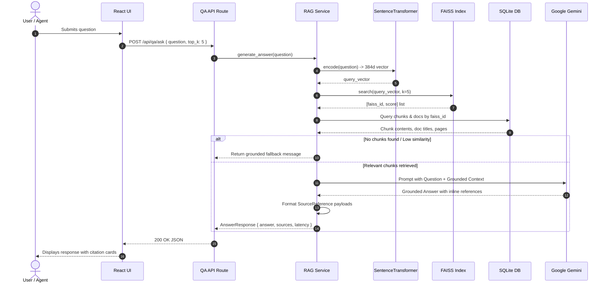

# Orbit — System Architecture Specification

## 1. System Overview

**Orbit** is an AI-powered intelligent support and knowledge assistant built with a modular decoupled architecture:
- **Client Tier:** React 18 single-page application built with Vite, TypeScript, and Tailwind CSS.
- **API Tier:** FastAPI application serving REST endpoints with Pydantic validation and JWT authentication.
- **Service Tier:** Domain services for PDF extraction, embedding generation, FAISS vector indexing, RAG orchestration, and ticket classification.
- **Data Tier:** SQLite relational database managed by SQLAlchemy and local FAISS vector indices on disk.

```mermaid
flowchart TD
    User([End User / Support Agent]) -->|HTTPS / REST| Frontend[React + Vite Frontend]
    Frontend -->|JWT Auth Header| API[FastAPI Application Gateway]
    
    subgraph API Tier
        API --> AuthRoute[/api/auth]
        API --> TicketRoute[/api/tickets]
        API --> DocRoute[/api/documents]
        API --> QARoute[/api/qa]
        API --> AnalyticsRoute[/api/analytics]
    end

    subgraph Service Tier
        DocRoute --> PDFService[PDF Service - PyMuPDF]
        DocRoute --> ChunkerService[Text Chunker & Cleaner]
        ChunkerService --> EmbedService[Embedding Service - SentenceTransformers]
        EmbedService --> FAISSService[FAISS Vector Store]
        
        TicketRoute --> ClassifierService[Ticket Classifier]
        
        QARoute --> RAGService[RAG Orchestrator]
        RAGService --> FAISSService
        RAGService --> GeminiService[Google Gemini Client]
    end

    subgraph Data Tier
        AuthRoute --> SQLite[(SQLite Database)]
        TicketRoute --> SQLite
        DocRoute --> SQLite
        DocRoute --> UploadsDir[Disk: PDF Storage]
        FAISSService --> FAISSIndex[Disk: index.faiss + chunks.pkl]
    end
```

---

## 2. Locked Technology Stack & Rationale

| Layer | Technology | Version | Rationale |
|---|---|---|---|
| **Frontend Framework** | React + Vite | React 18.3, Vite 6.4 | Rapid hot-module replacement, TypeScript safety, efficient production bundles. |
| **Styling** | Tailwind CSS | 3.4.17 | Consistent design tokens, dark slate theme, responsive layout. |
| **Backend Framework** | FastAPI | 0.115.11 | High performance, automatic OpenAPI documentation, strict request validation. |
| **Database** | SQLite + SQLAlchemy | SQLAlchemy 2.0.38 | Zero-configuration local database, transactional consistency, synchronous session stability on Python 3.14. |
| **Authentication** | Direct Bcrypt + PyJWT | bcrypt 5.0.0, PyJWT 2.10.1 | Industry-standard password hashing with 72-byte safe boundary and signed HS256 bearer tokens. |
| **PDF Extraction** | PyMuPDF (`fitz`) | 1.24.14 | High-fidelity text and page metadata extraction without external binaries. |
| **Embeddings** | Sentence Transformers | 3.3.1 (`all-MiniLM-L6-v2`) | High-speed 384-dimensional dense semantic vectors, low memory footprint, offline capable. |
| **Vector Index** | FAISS | faiss-cpu 1.15.1 | `IndexFlatIP` inner product on L2-normalized vectors delivers exact cosine similarity search with sub-millisecond latency. |
| **LLM Provider** | Google Gemini | `gemini-1.5-flash` | Fast generation, cost efficiency, and strong reasoning for grounded context synthesis. |

---

## 3. Detailed Component Architecture

### 3.1 Database Schema (SQLAlchemy)

1. **`users`**
   - `id` (INTEGER, Primary Key)
   - `email` (VARCHAR, Unique, Indexed)
   - `hashed_password` (VARCHAR)
   - `full_name` (VARCHAR)
   - `is_active` (BOOLEAN)
   - `created_at` (DATETIME)
2. **`tickets`**
   - `id` (INTEGER, Primary Key)
   - `title` (VARCHAR)
   - `description` (TEXT)
   - `status` (VARCHAR: `open`, `in_progress`, `resolved`, `closed`)
   - `priority` (VARCHAR: `low`, `medium`, `high`, `urgent`)
   - `category` (VARCHAR: `Account`, `Billing`, `Technical`, `Cancellation`, `Feature`, `Security`, `Other`)
   - `ai_category` (VARCHAR, Auto-predicted)
   - `ai_category_confidence` (FLOAT)
   - `user_id` (INTEGER, Foreign Key -> `users.id`)
   - `resolution_notes` (TEXT, Nullable)
   - `created_at`, `updated_at` (DATETIME)
3. **`documents`**
   - `id` (INTEGER, Primary Key)
   - `filename` (VARCHAR)
   - `original_filename` (VARCHAR)
   - `file_path` (VARCHAR)
   - `file_size` (INTEGER)
   - `total_pages` (INTEGER)
   - `total_chunks` (INTEGER)
   - `uploaded_by` (INTEGER, Foreign Key -> `users.id`)
   - `created_at` (DATETIME)
4. **`document_chunks`**
   - `id` (INTEGER, Primary Key)
   - `document_id` (INTEGER, Foreign Key -> `documents.id`)
   - `chunk_index` (INTEGER)
   - `page_number` (INTEGER)
   - `content` (TEXT)
   - `faiss_id` (INTEGER, Indexed)
   - `created_at` (DATETIME)

---

### 3.2 RAG & Vector Search Pipeline



---

### 3.3 Ticket Classification Pipeline

Tickets are classified automatically upon creation:
1. **Rule/Keyword Classifier:** Uses a keyword vocabulary scoring engine across `Account`, `Billing`, `Technical`, `Cancellation`, `Feature`, and `Security`.
2. **Confidence Computation:** Evaluates the relative margin of the top match against total candidate matches.
3. **LLM Augmentation:** When Gemini is enabled and keyword confidence is below threshold, an LLM zero-shot classification query is dispatched.
4. **Fallback:** Defaults to `Other` with low confidence if no matches are detected.

---

## 4. REST API Endpoint Reference

| Method | Path | Auth Required | Description |
|---|---|---|---|
| `GET` | `/health` | No | Health check, API version, and database status |
| `POST` | `/api/auth/register` | No | Register new user account |
| `POST` | `/api/auth/login` | No | OAuth2 password token login |
| `GET` | `/api/auth/me` | Yes | Get authenticated user profile |
| `GET` | `/api/tickets/` | Yes | List tickets with optional status/category filters |
| `POST` | `/api/tickets/` | Yes | Create a ticket (triggers auto-classification) |
| `GET` | `/api/tickets/{id}` | Yes | Retrieve ticket details by ID |
| `PATCH` | `/api/tickets/{id}` | Yes | Update ticket status, priority, or resolution notes |
| `POST` | `/api/documents/upload` | Yes | Upload and index a PDF document |
| `GET` | `/api/documents/` | Yes | List all indexed documents |
| `DELETE` | `/api/documents/{id}` | Yes | Delete document and remove chunks from index |
| `POST` | `/api/qa/ask` | Yes | Ask question against indexed documentation |
| `GET` | `/api/analytics/stats` | Yes | Summary analytics for dashboard |
| `GET` | `/api/analytics/vector-store` | Yes | FAISS index status and vector metrics |

---

## 5. Security Architecture

1. **Authentication:** Stateless JSON Web Tokens (JWT) signed using HMAC-SHA256 with expiration timestamps (default 60 minutes).
2. **Password Hashing:** Direct `bcrypt` with unique salt per password and strict 72-byte truncation boundary.
3. **Data Isolation:** User tickets and document ownership are linked directly to `user_id`.
4. **Input Sanitization:** PyMuPDF text cleaning strips null bytes and unprintable Unicode control characters.
5. **No Secret Leakage:** `.env` is ignored by `.gitignore`. API keys are loaded via Pydantic `BaseSettings`.
